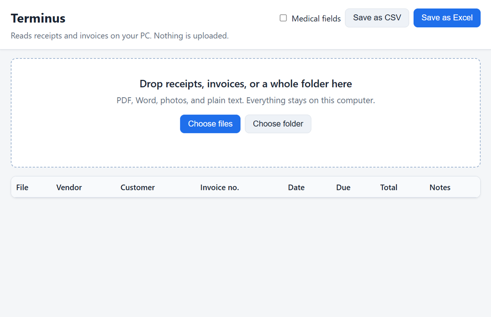

<p align="center">
  
</p>

# Terminus

Drop in your receipts and invoices; get a clean spreadsheet. Runs on your own PC — no AI, nothing uploaded.



## Download and run

### Windows

1. Download `docparse.exe` from the [Releases](../../releases) page into a folder you control (for example `C:\Tools\Terminus\`).
2. Double-click is not wired yet — open **Command Prompt** or **PowerShell** in that folder and run:

   ```text
   docparse ui
   ```

   Your browser opens to the Terminus screen. Drop files on the big area, then use **Save as Excel** or **Save as CSV**.

### Linux

```bash
go build -o docparse ./cmd/docparse
./docparse ui
```

### Scans and phone photos

Scanned PDFs and phone photos are read with **Tesseract** (free OCR). Terminus is not sending your files anywhere.

- **Windows:** [UB Mannheim Tesseract builds](https://github.com/UB-Mannheim/tesseract/wiki). Terminus also looks in `C:\Program Files\Tesseract-OCR\tesseract.exe` when Tesseract is not on your PATH.
- **Linux:** `sudo apt install tesseract-ocr` (or your distro’s package)

Point `TESSDATA_PREFIX` at the `tessdata` folder if the installer does not do it for you.

**Scanned PDFs:** Terminus pulls embedded page images out of the PDF first and runs OCR on them — you do not need Poppler for most phone scans (colour JPEG and greyscale work; black-and-white fax-style pages are supported too). If a page still needs rendering, Terminus can use **Poppler** (`pdftoppm`) from a `poppler\` folder next to `docparse.exe` (GPL — see `poppler/README.txt`) or from your PATH. Poppler is optional backup only.

## What it finds

Terminus labels each file with a **document type** (invoice, bank statement, letter, medical record, or general document) and fills in fields it can see on the page.

On ordinary bills and receipts:

- **Vendor** — who sent the bill  
- **Customer** — who it was sent to (Bill to / Customer / Sold to)  
- **Invoice number**  
- **Date** and **due date** when the document states them (ISO `YYYY-MM-DD`, with the original wording kept separately)  
- **Total** (amount due, not subtotal)

Turn on **Medical fields** on the screen (or use `--pack medical` on the command line) for patient name, MRN, admitted/discharged dates, attending physician, and similar labels on clinical documents. Dates use the same ISO format with originals kept. The medical pack helps you keep records private on your PC; **compliance with HIPAA or any other law is your responsibility** — Terminus does not claim legal compliance.

Missing fields are left blank — Terminus does not guess.

## For developers

Build:

```bash
go build -o dist/docparse.exe ./cmd/docparse   # Windows
go test ./...
```

| Command | Purpose |
|---------|---------|
| `docparse ui` | Local screen at `http://127.0.0.1:8765/` |
| `docparse parse <file>` | JSON with `fields`, `document_type`, `pages`, `warnings` |
| `docparse text <file>` | Plain text only |
| `docparse check <dir>` | Parse every PDF in a folder (regression / QA) |
| `docparse heal <file>` | Repair report + healed copy when possible |
| `docparse batch --in <dir> --out <dir>` | One JSON file per input |
| `docparse serve --port 8765` | Same server as `ui`, without opening the browser |

Example:

```bash
docparse parse C:\bills\invoice.txt
```

```json
{
  "status": "ok",
  "document_type": "invoice",
  "fields": {
    "vendor": "ACME SUPPLY CO.",
    "customer": "Harbor Cafe LLC",
    "invoice_number": "INV-2041",
    "date": "2026-09-03",
    "total": "258.23"
  }
}
```

Environment:

- `TERMINUS_WORKSPACE` — working folder (default: `./workspace`). `JANUS_WORKSPACE` still works (legacy).
- `TERMINUS_PACKS` — e.g. `medical`
- `TERMINUS_SAFE_MODE` — blocks risky shell commands (default on). `JANUS_SAFE_MODE` still works (legacy).
- `TERMINUS_MEDICAL_STRICT` — with the medical pack, blocks outbound network from tools. `TERMINUS_HIPAA_STRICT` and `JANUS_HIPAA_STRICT` still work (legacy).

Regression PDFs (optional): put your own test PDFs in a folder, set `TERMINUS_REGRESSION_PDFS` to it, and run `go test ./...` (or `docparse check <folder>`).

## Honest limits

From real runs on 96 real PDFs (books, papers, manuals, datasheets, cheat sheets and scans; October 2026):

- **95 of 96 read, none crashed.** 90 came out clean; 5 have a warning about symbols (icon fonts in cheat sheets, an unusual code font) while their text is still there.
- **Locked PDFs** that open without a password (common for bank and phone statements) are read normally, including locked scans. A PDF that needs a password says so; save a copy without the password first.
- **Text turned into drawings** (the 1 of 96 that didn't read): some PDFs store words as drawn shapes, with no text inside. Terminus says so; with Poppler installed it can read those pages with OCR.
- **Bills, receipts, statements, letters and medical records** get fields. Other documents (books, manuals) get their text, title and page count, not guessed bill fields.
- **Handwriting** — not reliable; typed or printed text works best.
- **Very poor scans and photos at a sharp angle** — Tesseract may return little or no text; install Tesseract and try a flatter, brighter photo.
- **Symbol-font PDFs** (keyboard icons, dingbats) — text is cleaned up and you get a warning; some icons are dropped rather than guessed.
- **Damaged PDFs** — Terminus tries to recover text and says so in `warnings`, not in the exported body text.
- **Unusual layouts** — tables and multi-column PDFs can confuse line-based reading.
- **No made-up numbers** — if a field is not on the page, it stays empty.

## Like it?

Terminus is free and stays free. If it saves you time, a star on GitHub helps other people find it.

Want it to run by itself (watch a folder, fill a spreadsheet every day)? **Vibe Engine**, my paid tool, runs Terminus and my other tools together, the same way every time: [adeptuscamini.com](https://adeptuscamini.com). Either way, thanks for using it.

## License

MIT. See [LICENSE](LICENSE).

---

<p align="center"><i lang="la" title="We refuse to keep doing the same broken things; we do other things.">Recusamus pergere eadem fracta facere; nos alia facimus.</i></p>
