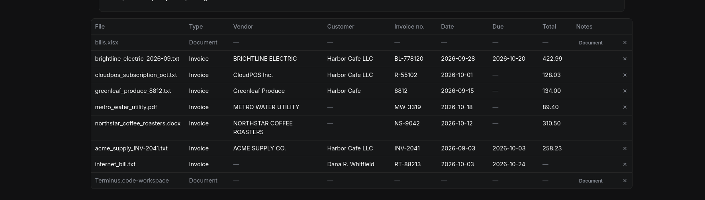
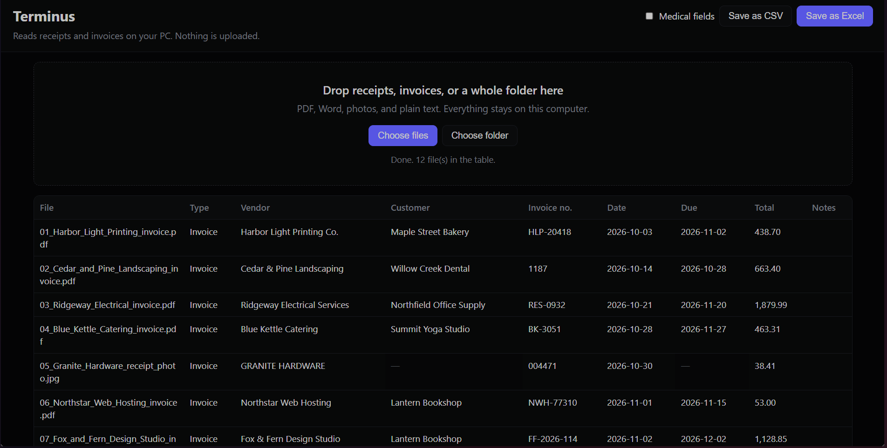
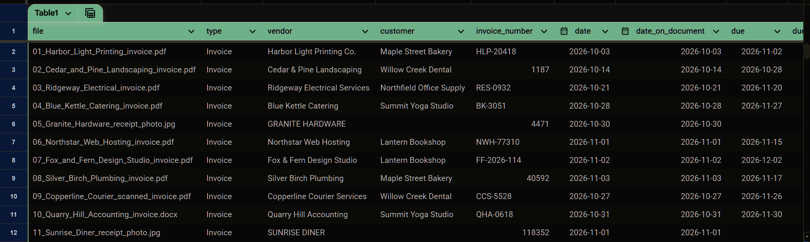
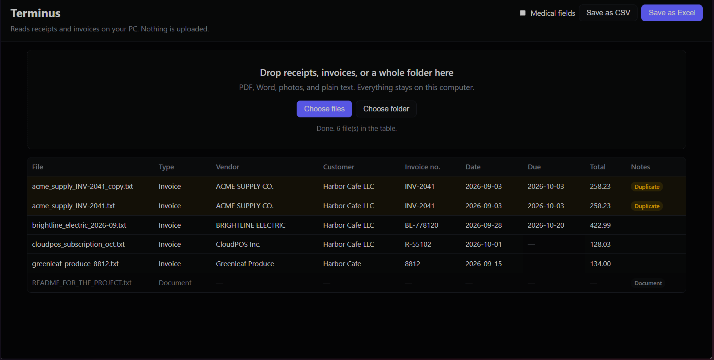
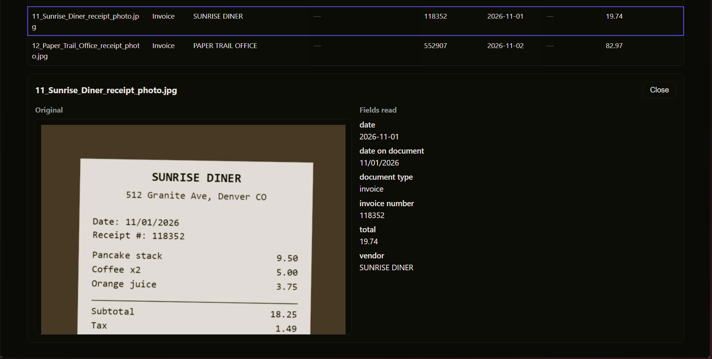
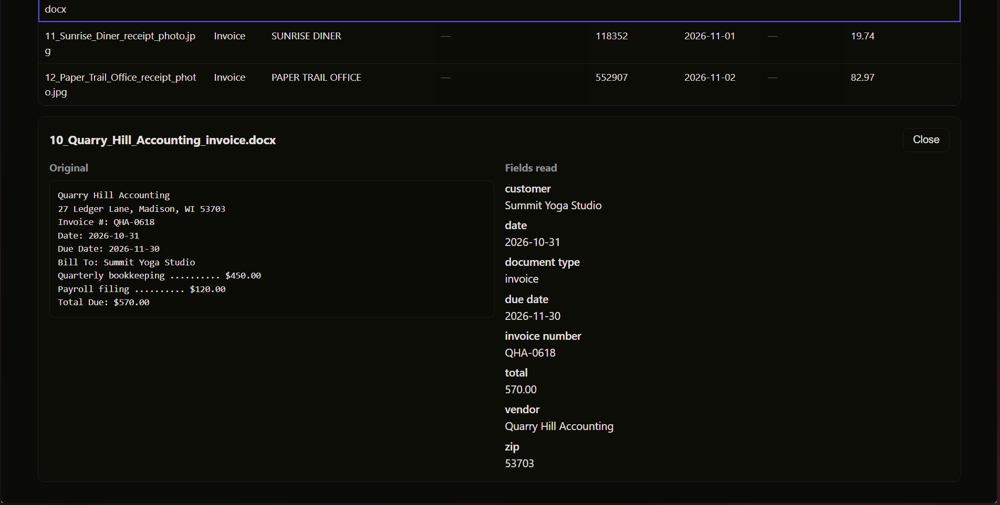

<p align="center">
  
</p>

# Terminus

Drop in your receipts and invoices; get a clean spreadsheet, Markdown, or files for your own AI tools. Runs on your own PC — no AI, nothing uploaded.



## See it work

**A pile of documents becomes one table.** Twelve test files (PDFs, a Word file and phone photos) dropped in at once:



Saved and opened as a spreadsheet, with no typing:



**Duplicates are caught.** The same invoice dropped in twice is marked, so it isn't counted twice:



**Before and after, one document at a time.** Click a row to see the original next to what Terminus read from it.

A phone photo of a diner receipt:



A Word invoice:



All the documents in these pictures are made-up test files.

## New in 1.1.0

- **Tax-time pack**: a year of receipts and bills added up by category, month and vendor, in one workbook for your accountant.
- **Budget from bank statements**: reads the transaction lines from bank CSV exports and text PDFs, shows money in, money out and spending by category each month, and checks the lines against the bank's own closing balance.
- **Fill a PDF form** from your own details and documents. You see every answer and where it came from before anything is written; the original form is never changed.
- **Watch a folder**: files dropped into an Inbox folder are read and added to a running spreadsheet, and filed if you switch that on.
- **Tidy a folder**: messy downloads filed into Bills, Bank statements, Letters and more. Preview first, never deletes, one-step undo.
- **Pictures from documents**: images pulled out next to the Markdown, and the words inside them read with OCR.
- **More ways out**: Markdown, JSON and a folder an AI tool can read, plus a close-out button for finished rows.

All of it runs on your own PC, with plain rules and no AI. Your files are only read; nothing is uploaded.

## Download and run

### Windows

1. Download **[Terminus-windows.zip](../../releases/latest/download/Terminus-windows.zip)** and unzip it into a folder you control (for example `C:\Tools\Terminus\`).
2. Double-click `docparse.exe`. Your browser opens to the Terminus screen. Drop files on the big area, then use **Save as Excel** (real `.xlsx`), **Save as CSV**, **Copy table**, or **Save as JSON**. Close the black window to stop Terminus.

   Windows may say "Windows protected your PC" the first time, because Terminus is new and not yet widely downloaded. Click **More info**, then **Run anyway**.

From a terminal, `docparse help` lists every command (`parse`, `batch`, `text`, `check`, `heal`, `serve`).

### Linux

```bash
go build -o docparse ./cmd/docparse
./docparse ui
```

### Scans and phone photos

Scanned PDFs and phone photos are read with **Tesseract** (free OCR). Terminus is not sending your files anywhere.

- **Windows:** [UB Mannheim Tesseract builds](https://github.com/UB-Mannheim/tesseract/wiki). Terminus also looks in `C:\Program Files\Tesseract-OCR\tesseract.exe` when Tesseract is not on your PATH.
- **Linux:** `sudo apt install tesseract-ocr` (or your distro’s package)

Point `TESSDATA_PREFIX` at the `tessdata` folder if the installer does not do it for you.

**Scanned PDFs:** Terminus pulls embedded page images out of the PDF first and runs OCR on them — you do not need Poppler for most phone scans (colour JPEG and greyscale work; black-and-white fax-style pages are supported too). If a page still needs rendering, Terminus can use **Poppler** (`pdftoppm`) from a `poppler\` folder next to `docparse.exe` (GPL — see `poppler/README.txt`) or from your PATH. Poppler is optional backup only.

## What it finds

Terminus labels each file with a **document type** (invoice, bank statement, letter, medical record, or general document) and fills in fields it can see on the page.

On ordinary bills and receipts:

- **Vendor** — who sent the bill  
- **Customer** — who it was sent to (Bill to / Customer / Sold to)  
- **Invoice number**  
- **Date** and **due date** when the document states them (ISO `YYYY-MM-DD`, with the original wording kept separately)  
- **Total** (amount due, not subtotal)

Turn on **Medical fields** on the screen (or use `--pack medical` on the command line) for patient name, MRN, admitted/discharged dates, attending physician, and similar labels on clinical documents. Dates use the same ISO format with originals kept. The medical pack helps you keep records private on your PC; **compliance with HIPAA or any other law is your responsibility** — Terminus does not claim legal compliance.

Missing fields are left blank — Terminus does not guess.

## Ways to get your data out

| Format | Who it's for |
|--------|----------------|
| **Excel (`.xlsx`)** | Spreadsheets in Microsoft Excel or LibreOffice — totals stay numbers you can sum. |
| **CSV** | Any spreadsheet or database import. |
| **Copy table** | Paste straight into Google Sheets or Excel. |
| **JSON** | Your own scripts, automations, or AI tools on your PC. |
| **Markdown** | Clean text for notes, wikis, or RAG — headings and tables when the layout allows. |
| **AI skill (zip)** | A folder an AI (Claude, Cursor, and others) can open for lookup — split by section, not one giant paste. |
| **Training file (`.jsonl`)** | Plain `{"text": "..."}` lines for Unsloth-style fine-tuning — teaches style and wording, **not** reliable facts. For lookup, use an AI skill instead. |

## For developers

Build:

```bash
go build -o dist/docparse.exe ./cmd/docparse   # Windows
go test ./...
```

| Command | Purpose |
|---------|---------|
| `docparse ui` | Local screen at `http://127.0.0.1:8765/` |
| `docparse parse <file>` | JSON with `fields`, `document_type`, `pages`, `warnings` |
| `docparse text <file>` | Plain text only |
| `docparse check <dir>` | Parse every PDF in a folder (regression / QA) |
| `docparse heal <file>` | Repair report + healed copy when possible |
| `docparse batch --in <dir> --out <dir>` | One JSON file per input |
| `docparse batch --in <dir> --out <dir> --format xlsx` | One workbook with all rows |
| `docparse markdown <file> [-o out.md]` | Clean Markdown; with `-o`, saves pictures in `out_images/` and links them |
| `docparse skill <paths...> --name <id> -o <dir> [--description "..."]` | AI skill folder; pictures go in `images/` with `images/index.json` (`file`, `page`, `width`, `height`, `ocr_text`, `description` — `description` stays empty for a later vision step) |
| `docparse train <paths...> -o data.jsonl [--words 800]` | Training JSONL |
| `docparse serve --port 8765` | Same server as `ui`, without opening the browser |
| `docparse tidy <folder>` | Preview where files would go (nothing moves) |
| `docparse tidy <folder> --apply` | File them (undo file written first) |
| `docparse tidy --undo <undo.json>` | Put every file back |
| `docparse watch <inbox>` | Watch a folder: read new files, append to `Terminus sheet.xlsx` |
| `docparse watch <inbox> --file-them` | Same, and file each document with tidy rules (undo first) |
| `docparse watch <inbox> --once` | Process stable files now and exit (for scripts) |

## Watch an Inbox folder

Drop bills and scans into one folder (your Inbox). Terminus polls every five seconds, waits until each file stops changing, reads it, and **appends** a row to **`Terminus sheet.xlsx`** and **`Terminus sheet.csv`** in that folder (same columns as the tax pack's *Every document* sheet).

- **File them for me** is **off** by default: read + spreadsheet only; **nothing moves**.
- With **`--file-them`**, each read file is filed with the same rules as **`docparse tidy`**. An undo file is written **before** each move.
- Temp names (`.part`, `.crdownload`, `.tmp`, `~$…`), hidden files, and the spreadsheet itself are ignored.
- The same **content** is never processed twice (SHA-256 remembered in your Terminus workspace, not inside the Inbox).

```bash
docparse watch ~/Inbox
docparse watch ~/Inbox --file-them
docparse watch ~/Inbox --sheet "~/Inbox/My running sheet.xlsx"
```

The **Watch a folder** panel on the local screen can start and stop the same watcher on the server.

### Keep it running

**Linux (systemd user unit)** — adjust paths, then:

```ini
# ~/.config/systemd/user/terminus-watch.service
[Unit]
Description=Terminus watch Inbox
After=default.target

[Service]
Type=simple
ExecStart=/usr/local/bin/docparse watch %h/Inbox
Restart=on-failure

[Install]
WantedBy=default.target
```

```bash
systemctl --user enable --now terminus-watch.service
```

**Windows** — Task Scheduler: trigger *At log on*, action `docparse.exe watch C:\Users\You\Inbox` (add `--file-them` if you want filing). Use *Run whether user is logged on or not* only if you understand how that account can reach the folder.

To run the web screen at login without opening a browser, set `TERMINUS_NO_OPEN_BROWSER=true` before `docparse serve`.

## Tidy a folder

Messy Downloads folders are common: `scan0012.pdf`, `document (3).pdf`, the same bill saved twice. Terminus already reads those files. **Tidy** uses what it found to sort them into folders.

**Safety (plain words):**

- **Preview first.** `docparse tidy ~/Downloads` prints a plan. Nothing moves until you add `--apply`.
- **Nothing is deleted.** Exact copies go to `Duplicates (exact copies)/` with their names kept.
- **Never overwrites.** If two files would get the same name, Terminus adds ` (2)`, ` (3)`, and so on.
- **Undo.** Every apply writes `<folder>/.terminus-undo-<date>-<time>.json` *before* any move. `docparse tidy --undo that-file.json` puts files back and refuses if something changed.

Folder rules use Terminus's own `document_type`, vendor, and date:

- Invoices → `Bills/Invoices/<year>/<vendor>/`
- Receipts → `Bills/Receipts/<year>/<vendor>/`
- Bank statements → `Bank statements/<year>/<bank>/`
- Letters → `Letters/`; medical → `Medical/`
- Other documents → `Documents/<topic>/` from keyword rules (or plain `Documents/`)

Unreadable files (images, zips, and similar) stay where they are unless they are byte-for-byte duplicates.

**Custom topic rules** (optional JSON):

```json
{"Gardening": ["garden", "plant", "soil", "compost"]}
```

```bash
docparse tidy ~/Downloads --rules my-rules.json
```

Built-in topics include Programming, Security, Networking, AI, Taxes, Insurance, and Manuals (3+ keyword hits required). See `docparse tidy --help` for the format.

**Optional local model (off by default):** `--model-url http://127.0.0.1:8990` may pick a topic for documents keyword rules could not place. Only `localhost` URLs are accepted.

Example:

```bash
docparse parse C:\bills\invoice.txt
```

```json
{
  "status": "ok",
  "document_type": "invoice",
  "fields": {
    "vendor": "ACME SUPPLY CO.",
    "customer": "Harbor Cafe LLC",
    "invoice_number": "INV-2041",
    "date": "2026-09-03",
    "total": "258.23"
  }
}
```

Environment:

- `TERMINUS_WORKSPACE` — working folder (default: `./workspace`). `JANUS_WORKSPACE` still works (legacy).
- `TERMINUS_PACKS` — e.g. `medical`
- `TERMINUS_SAFE_MODE` — blocks risky shell commands (default on). `JANUS_SAFE_MODE` still works (legacy).
- `TERMINUS_MEDICAL_STRICT` — with the medical pack, blocks outbound network from tools. `TERMINUS_HIPAA_STRICT` and `JANUS_HIPAA_STRICT` still work (legacy).

Regression PDFs (optional): put your own test PDFs in a folder, set `TERMINUS_REGRESSION_PDFS` to it, and run `go test ./...` (or `docparse check <folder>`).

## Tax-time pack

```bash
docparse taxpack ~/Receipts --year 2026
```

Adds up every receipt, invoice and bill dated in that year by category, month and vendor, and writes `Tax pack 2026.xlsx` (plus a CSV) into the folder. Each line says how its category was decided. Copies of the same bill are counted once, bills with no readable total are listed under **Needs a look** instead of being added in, and different currencies are never added together. Change a category once (`--set-category "Acme Supply=Office & supplies"`, or the dropdown on the screen) and it sticks. Terminus adds up what it read; it doesn't decide what's deductible.

## Budget from bank statements

```bash
docparse budget ~/Statements --year 2026
```

Reads the transaction lines from bank CSV exports (separate money-in/money-out columns or one signed amount; `1,234.56` and `1.234,56`; US and day-first dates) and from text PDF statements. Writes `Budget 2026.xlsx` with money in, money out and what's left each month, spending by category, and the top places your money went. When a statement prints its opening and closing balance, Terminus checks the lines add up and tells you plainly if something is missing. The same statement saved twice is counted once.

## Fill a PDF form

```bash
docparse form application.pdf --from ~/Invoices          # shows the plan, writes nothing
docparse form application.pdf --from ~/Invoices --apply  # writes "application (filled).pdf"
```

Fills a PDF form's boxes from your **My details** profile and the documents you point at. The plan lists every box, the proposed answer and where it came from. Boxes with no clear answer stay empty; two different answers are both shown and neither is used. ID, bank and card numbers are never taken from documents, only from what you typed into your own profile. The original form is never changed.

## Honest limits

From real runs on 96 real PDFs (books, papers, manuals, datasheets, cheat sheets and scans; October 2026):

- **95 of 96 read, none crashed.** 90 came out clean; 5 have a warning about symbols (icon fonts in cheat sheets, an unusual code font) while their text is still there.
- **Locked PDFs** that open without a password (common for bank and phone statements) are read normally, including locked scans. A PDF that needs a password says so; save a copy without the password first.
- **Text turned into drawings** (the 1 of 96 that didn't read): some PDFs store words as drawn shapes, with no text inside. Terminus says so; with Poppler installed it can read those pages with OCR.
- **Bills, receipts, statements, letters and medical records** get fields. Other documents (books, manuals) get their text, title and page count, not guessed bill fields.
- **Handwriting** — not reliable; typed or printed text works best.
- **Very poor scans and photos at a sharp angle** — Tesseract may return little or no text; install Tesseract and try a flatter, brighter photo.
- **Symbol-font PDFs** (keyboard icons, dingbats) — text is cleaned up and you get a warning; some icons are dropped rather than guessed.
- **Damaged PDFs** — Terminus tries to recover text and says so in `warnings`, not in the exported body text.
- **Unusual layouts** — tables and multi-column PDFs can confuse line-based reading.
- **No made-up numbers** — if a field is not on the page, it stays empty.

## Like it?

Terminus is free and stays free. If it saves you time, a star on GitHub helps other people find it.

Want it to do more by itself (read your email attachments, file them, and tell you what needs you today)? **Vibe Engine**, my paid tool, runs Terminus and my other tools together, the same way every time: [adeptuscamini.com](https://adeptuscamini.com). Either way, thanks for using it.

## License

MIT. See [LICENSE](LICENSE).

---

<p align="center"><i lang="la" title="We refuse to accept the same broken things, we build differently!">Recusamus eadem fracta accipere. Nos aliter aedificamus.</i><br><sub>We refuse to accept the same broken things, we build differently!</sub></p>
